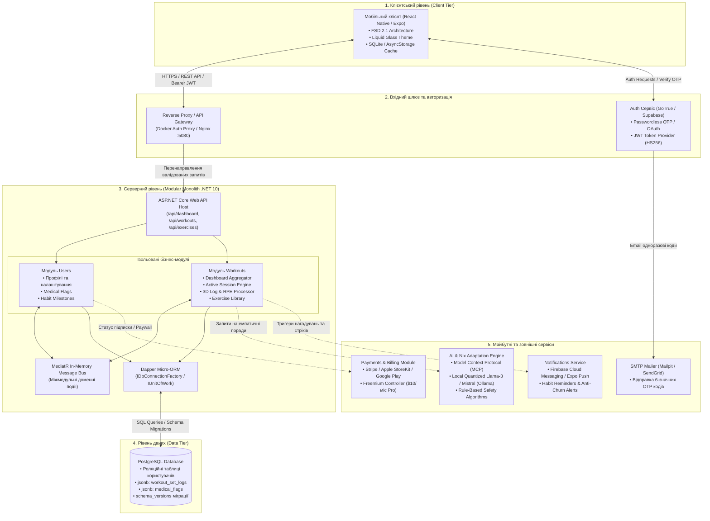

# Бізнес-документ системи FitSync AI (Shyft)

> **Практична робота №2:** Бізнес-документ і архітектурна діаграма  
> **Проєкт:** FitSync AI (кодова база Shyft)  
> **Версія:** 1.0 (MVP Phase)  
> **Статус:** Затверджено  

---

## 1. Назва системи та короткий опис

**Назва системи:** FitSync AI (робоча платформа Shyft)

FitSync AI — це інноваційна мобільна фітнес-екосистема нового покоління, створена для кардинальної зміни взаємодії людини з фізичними навантаженнями: від «пасивного цифрового блокнота» до «активного емпатичного наставника». Більшість існуючих рішень на ринку є перевантаженими сухими таблицями-калькуляторами, які лише підвищують рівень когнітивного стресу для користувача. FitSync AI фокусується на ключовому психологічному бар'єрі новачків — феномені «gymtimidation» (страх і соціальна тривожність перед відвідуванням спортзалу, страх осуду, невпевненість у правильності виконання вправ чи взаємодії з обладнанням).

Центральним ядром платформи є **Nix** — емпатичний цифровий AI-наставник, що супроводжує атлета на кожному кроці тренувального шляху. Завдяки концепції «Thinking UI» система відкрито демонструє логіку формування навантажень, враховуючи індивідуальні особливості опорно-рухового апарату (наприклад, сколіоз або біль у суглобах) ще на етапі онбордингу. Головною кілер-фічею проєкту є алгоритмічна динамічна адаптація тренування в реальному часі: якщо атлет відчуває перевтому або необхідний тренажер у залі зайнятий, система миттєво коригує план просто під час підходу, захищаючи центральну нервову систему (ЦНС) та хребет користувача.

Архітектурно система поєднує високу швидкість та відмовостійкість: клієнтський мобільний застосунок побудований на **React Native (Expo)** за стандартами дизайну **Liquid Glass** (контрастні неонові кольори на темному фоні для легкого зчитування інформації в залі), а серверне ядро реалізовано у вигляді модульного моноліта на **ASP.NET Core (.NET 10)** з базою даних **PostgreSQL**. Для збереження тривимірних логів підходів (вага, повторення, темп TUT, ізометричне утримання) використовується високоефективний формат **JSONB**, що забезпечує гнучкість без шкоди продуктивності реляційної моделі.

---

## 2. Користувачі та їхні ролі

Система розрахована на чотири основні ролі користувачів із чітким розмежуванням прав доступу, інтерфейсних сценаріїв та функціональних можливостей:

| Роль | Опис ролі | Ключові потреби та поведінкові патерни |
| :--- | :--- | :--- |
| **1. Новачок (Gymtimidated Novice)** | Користувач без досвіду або з великою перервою у тренуваннях, який відчуває психологічний дискомфорт та тривожність у залі. | Потребує простого, неперевантаженого інтерфейсу, домашньої адаптаційної програми («Home-to-Gym Bridge Plan»), візуальних підказок техніки, швидкої заміни вправ при зайнятих тренажерах та емпатичної підтримки AI-коуча. |
| **2. Регулярний атлет (Active Trainee)** | Користувач, який стабільно тренується, розуміє принципи прогресивного перевантаження та прагне результату. | Фіксація тривимірних показників (темп 4-0-1-0, вага, повторення), оцінка сприйняття навантаження (RPE), трекінг персональних рекордів, аналітика тижневого об'єму (Volume Load). |
| **3. Преміум-користувач (Pro Subscriber)** | Користувач, який завершив 8 безкоштовних пробних тренувань та оформив підписку ($10/місяць). | Безлімітний інтерактивний AI-чат з Nix, доступ до просунутого метронома часу під навантаженням (TUT), превентивний захист від плато та перетренованості (Anti-Churn Agent), глибока аналітика прогресу. |
| **4. Контент-адміністратор / Куратор вправ (Admin / Content Curator)** | Внутрішній фахівець команди або спортивний лікар/методист. | Керування базою вправ (`ExerciseLibrary`), налаштування біомеханічних тегів (м'язові групи, тип навантаження, осьове навантаження на хребет), моніторинг стабільності системи та оновлення алгоритмічних матриць замін. |

---

## 3. Основні сценарії використання (Use Cases)

### Сценарій 1 (UC-1): Емпатичний онбординг з «Thinking UI» та скринінг обмежень здоров'я
1. Користувач завантажує додаток і проходить швидку безпарольну реєстрацію через Email (OTP Magic Link) або Apple/Google ID.
2. Система опитує користувача щодо цілей, поточного рівня підготовки та наявності медичних особливостей (наприклад, сколіоз, травми колін, протрузії).
3. Замість звичайного спінера завантаження активується псевдотермінальний екран **«Thinking UI»**, що імітує реальну роботу алгоритмів AI Nix:
   - `[✓] Аналіз первинних цілей користувача...`
   - `[ALERT] Виявлено обмеження: сколіоз грудного відділу хребта.`
   - `[✓] Адаптація осьового навантаження... Виключення компресійних вправ.`
   - `[✓] Формування персонального стартового плану.`
4. Користувач бачить, що система подбала про його безпеку, отримує перший персоналізований план і позбавляється страху нашкодити здоров'ю.

### Сценарій 2 (UC-2): Плавний перехід із дому до залу («Home-to-Gym Bridge Plan»)
1. Для подолання бар'єра перед залом система призначає новачку початковий план **«Home Plan A»** (тренування з власною вагою та базовим домашнім спорядженням: килимок, гантелі).
2. Після кожного тренування система оновлює тижневий стрік (Streak Widget).
3. Після успішного виконання порогової кількості домашніх занять (наприклад, 4 послідовні тренування без пропусків) формується звичка до регулярності.
4. Nix надсилає мотиваційне сповіщення та відкриває доступ до **«Gym Plan B»**, пояснюючи навігацію тренажерним залом і знімаючи страх першого візиту.

### Сценарій 3 (UC-3): Проходження тренування з динамічною адаптацією на льоту
1. Користувач натискає кнопку «Start Workout» на головному екрані; інтерфейс плавно переходить у режим активного тренування з фіксованим баром активної вправи («Now Playing»).
2. **Кейс А («Я втомився»):** Під час виконання важкої вправи користувач відчуває виснаження і натискає кнопку «I’m Tired». Алгоритм миттєво знижує робочу вагу на наступні підходи на 10–15%, а Nix виводить підтримуючий текст: *«Безпека на першому місці! Я знизив вагу, щоб захистити твою ЦНС — дотиснемо тренування разом!»*.
3. **Кейс Б («Тренажер зайнятий»):** Потрібний тренажер для жиму або рама для присідань зайняті іншими відвідувачами. Користувач тисне «Machine Busy» — алгоритм негайно знаходить еквівалентну альтернативу з однаковим цільовим м'язовим стимулом, але з вільними вагами або гантелями.
4. Тренування продовжується без вимушених пауз та тривожного очікування.

### Сценарій 4 (UC-4): Фіксація тривимірного логу та калібрування навантаження (RPE 1–5)
1. Користувач відмічає фактично виконані підходи (вага, кількість повторень, тривалість утримання).
2. По завершенню останньої вправи користувач натискає «Finish Workout».
3. Система відображає конфеті-анімацію (Lottie) та пропонує оцінити загальну важкість сесії за шкалою RPE (Rate of Perceived Exertion) від 1 до 5:
   - `1 - Дуже легко:` наступного разу алгоритм збільшує вагу на +10–15%.
   - `2 - Комфортно:` помірна прогресія навантаження (+5%).
   - `3 - Оптимально:` збереження поточної лінійної прогресії.
   - `4 - Важко:` фіксація стану стабілізації/плато в JSONB.
   - `5 - Виснаження / Ризик травми:` негайне призначення розвантажувального тренування (Deload, -15–20% ваги).
4. Оновлені дані сесії та перерахована аналітика синхронізуються з сервером.

### Сценарій 5 (UC-5): Проактивне запобігання плато та відтоку (Anti-Churn & Deload)
1. Серверний фоновий аналітичний модуль сканує JSONB логи останніх тренувань користувача.
2. Якщо виявляється відсутність прогресу протягом 3 послідовних тренувань або часті оцінки RPE=4–5, агент ідентифікує фазу застою (Plateau).
3. Nix проактивно звертається до користувача через головний екран: пропонує провести запланований відновлювальний тиждень (Deload Week) або замінити вправу на біомеханічний аналог (наприклад, жим штанги замінити на жим гантелей під кутом).
4. Це запобігає перетренованості, демотивації та відмові від занять спортом.

---

## 4. Функціональні вимоги (FR)

| ID | Категорія | Опис функціональної вимоги |
| :--- | :--- | :--- |
| **FR-1** | Авторизація | Система повинна підтримувати безпарольну авторизацію через Email (OTP 6-значний код) та OAuth провайдерів (Google, Apple) через GoTrue Auth. |
| **FR-2** | Токени сесії | Кожен захищений API-запит повинен валідуватись через HS256 JWT Bearer токен. Ідентифікатор користувача витягується виключно з контексту токена (`IUserContext`), а не з тіла запиту. |
| **FR-3** | Онбординг | Система повинна забезпечувати покроковий скринінг цілей і медичних обмежень користувача з візуалізацією процесу через «Thinking UI». |
| **FR-4** | Збереження профілю | Система повинна зберігати персональні налаштування та медичні прапорці в зашифрованому полі `medical_flags` типу `JSONB` у PostgreSQL. |
| **FR-5** | Щоденний дашборд | Додаток повинен відображати екран `/api/dashboard` у трьох динамічних станах: `NotStarted` (до тренування), `InProgress` (активне тренування), `Finished` (підсумки дня). |
| **FR-6** | Каталог вправ | Система повинна надавати публічний API-довідник вправ з детальними інструкціями, необхідним інвентарем, м'язовими групами та альтернативами. |
| **FR-7** | Тренувальні плани | Користувач повинен мати можливість отримувати призначені плани (Bridge Plan A/B) та створювати власні тренувальні розклади (CRUD). |
| **FR-8** | Тривимірний лог | Система повинна зберігати логи кожного підходу у форматі `JSONB` (комбінації: вага / повторення / темп TUT 4-digit code / тривалість статики / дистанція). |
| **FR-9** | Адаптація «I’m Tired» | Система повинна алгоритмічно (без галюцинацій LLM) знижувати вагу вправ на 10–15% при натисканні тригера втоми. |
| **FR-10**| Адаптація «Machine Busy» | Система повинна підбирати безпечну альтернативну вправу без осьового стиснення хребта, якщо тренажер зайнятий. |
| **FR-11**| RPE калібрування | Після завершення тренування система повинна збирати оцінку RPE (1–5) та автоматично розраховувати вагові коефіцієнти для наступної сесії. |
| **FR-12**| Freemium Paywall | Система повинна надавати безкоштовний доступ на рівно 8 перших тренувань, після чого блокувати Pro-функціонал до оформлення підписки. |
| **FR-13**| Офлайн-режим | Клієнтський додаток повинен локально зберігати поточний стан сесії (`workoutState`) в `AsyncStorage` / `SQLite` та синхронізувати його після відновлення мережі. |

---

## 5. Нефункціональні вимоги (NFR)

* **NFR-1 (Швидкодія та Latency):**
  - Час відповіді сервера на запити читання дашборду (`GET /api/dashboard`) не повинен перевищувати **150 мс** на 95-му перцентилі (p95).
  - Холодний запуск мобільного додатку на пристроях середнього сегмента — до **2.0 секунд**.
  - Перемикання станів екрану під час тренування — до **16 мс** (стабільні 60 FPS).
* **NFR-2 (Надійність та збереження даних — Zero Data Loss):**
  - У разі збою живлення телефону або вивантаження додатку з пам'яті під час тренування, стан активного підходу та зафіксовані повторення відновлюються з локального сховища без втрат.
  - У разі відсутності інтернету в підвальному залі всі дії чергуються локально і надсилаються при появі зв'язку (Offline-First).
* **NFR-3 (Безпека даних та відповідність GDPR):**
  - Категорично заборонено збереження незашифрованих біометричних даних користувача.
  - Усі конфіденційні медичні примітки та обмеження опорно-рухового апарату зберігаються в зашифрованих `JSONB` блоках.
  - Автентифікація реалізується за стандартом OAuth 2.0 / JWT з використанням криптографічного ключа HS256 (`Auth:JwtSecret`).
* **NFR-4 (UX, дизайн та доступність — Accessibility):**
  - Дизайн інтерфейсу повинен суворо дотримуватися стандартів **Liquid Glass** та **WCAG 2.1 AA** з контрастністю не менше **4.5:1** (неонові акцентні елементи на глибокому темному фоні `#060607` для ідеальної читабельності під яскравими лампами залу).
  - Усі активні тач-таргети та кнопки для взаємодії під час тренування мають розмір не менше **48×48 dp**, щоб уникнути помилкових натискань тремтячими руками після підходу.
* **NFR-5 (Архітектурна модульність та чистота коду):**
  - Серверна частина будується за патерном **Modular Monolith** з повною ізоляцією модулів `Users` та `Workouts`. Заборонено прямі міжмодульні посилання на репозиторії — лише in-memory події через **MediatR**.
  - Фронтенд-архітектура суворо слідує **Feature-Sliced Design (FSD 2.1)** з односпрямованим потоком залежностей: `app -> pages -> widgets -> features -> entities -> shared`.

---

## 6. Обмеження системи (Non-Goals / Out of Scope)

Для збереження високої якості розробки MVP-версії та уникнення розмивання фокусу встановлено такі суворі обмеження:

1. **Жодного підрахунку калорій та щоденника харчування (No Nutritional Tracking):**  
   Система фокусується виключно на біомеханіці, психології подолання страху залу та адаптації тренувань. Облік БЖВ виключено для запобігання надмірному розростанню БД та прямій конкуренції з комерційними харчовими трекерами.
2. **Відсутність CRM-системи для живих тренерів (No Live Trainer CRM):**  
   Платформа не передбачає особистих кабінетів тренерів, розкладу залів чи чатів з людьми на стадії MVP — фокус зосереджений на побудові довіри між користувачем та AI-агентом Nix.
3. **Категорична заборона фотографій прогресу (No Progress Photo Storage):**  
   Зберігання зображень тіла користувачів повністю заборонено на рівні бізнес-правил та API з міркувань приватності та суворого дотримання регуляцій GDPR.
4. **Відсутність клієнтів для смарт-годинників (No Apple Watch / Wear OS Apps у MVP):**  
   Розробка зосереджена виключно на смартфонах (iOS та Android). Підтримка смарт-годинників відкладена до майбутніх релізів.
5. **Заборона генеративного розрахунку ваги через LLM (No LLM for Physical Loads):**  
   Коригування робочої ваги, кількості повторень та прогресивного перевантаження здійснюється **виключно детерміністичними математичними алгоритмами**. LLM використовується лише для емпатичного діалогу, підбадьорення та текстових порад, оскільки галюцинації нейромережі у розрахунку ваги штанги становлять загрозу життю та здоров'ю користувача.

---

## 7. Архітектурний опис та взаємодія модулів

Архітектура FitSync AI побудована за принципом модульного моноліта з чітким розділенням відповідальності та можливістю легкого винесення окремих модулів у мікросервіси в майбутньому.

### Пояснення кожного блоку системи:

1. **Мобільний клієнт (Client - React Native / Expo):**  
   Фронтенд-застосунок, організований за методологією Feature-Sliced Design. Відповідає за відображення інтерфейсу Liquid Glass, відстеження активних сесій, обробку жестів та локальне кешування в `AsyncStorage` / `SQLite` для повноцінної роботи в умовах відсутності зв'язку.
2. **Reverse Proxy / API Gateway (Вхідний шлюз):**  
   Єдина точка входу (`:5080`), що забезпечує маршрутизацію трафіку, TLS-термінацію, захист від перевантажень (Rate Limiting) та первинну перевірку наявності Bearer-токенів.
3. **GoTrue Auth Service (Сервіс автентифікації):**  
   Сумісний із Supabase сервіс ідентифікації, який забезпечує вхід без пароля через перевірку одноразового 6-значного коду (OTP), інтеграцію з Apple/Google Sign-In та генерацію криптографічно підписаних HS256 JWT токенів.
4. **ASP.NET Core Web API Host (Серверний моноліт):**  
   Головний бекенд-вузол на базі .NET 10, що містить глобальні фільтри безпеки, конвеєр обробки помилок, маршрутизацію та механізм `IUserContext` для безпечного отримання ідентифікатора користувача з клеймів JWT.
5. **Модуль Users:**  
   Ізольований бізнес-модуль, відповідальний за управління профілем користувача, фіксацію проходження кроків онбордингу, зберігання медичних обмежень у зашифрованому `JSONB` та перевірку статусу підписки.
6. **Модуль Workouts:**  
   Ключовий модуль бізнес-логіки. Керує генерацією дашборду, бібліотекою вправ, життєвим циклом тренувальної сесії (старт, пауза, динамічна адаптація навантаження, збереження тривимірних логів, розрахунок RPE та стріків).
7. **MediatR In-Memory Message Bus:**  
   Шина внутрішніх подій, яка гарантує слабку зв'язаність (loose coupling) між модулями `Users` та `Workouts`. Дозволяє реагувати на події (наприклад, `WorkoutCompletedEvent`) без прямого зв'язування сховищ даних.
8. **Dapper Micro-ORM & UnitOfWork:**  
   Високопродуктивний шар доступу до даних, який виконує оптимізовані сирі SQL-запити до PostgreSQL, виключаючи накладні витрати «важких» ORM і дозволяючи безпосередньо мапити складні структури `JSONB`.
9. **PostgreSQL Database (Рівень сховища):**  
   Головна реляційна база даних. Поєднує строгі реляційні схеми для користувачів та вправ із гібридними `JSONB` структурами для зберігання тривимірних метрик (вага, повторення, темп, тривалість статики) та версіонування міграцій.
10. **AI & Nix Adaptation Engine (AI-модуль):**  
    Сервіс, що об'єднує детерміністичні біомеханічні алгоритми безпеки (для ваг і замін) та локальну квантовану нейромережу (Llama-3 / Mistral через Ollama / MCP) для генерації персоналізованих емпатичних порад і реплік Nix.
11. **Notifications Service (Сервіс сповіщень — запланований модуль):**  
    Модуль фонових пуш-сповіщень через FCM / Expo Push для підтримки стріків, мотиваційних нагадувань та повернення користувачів у застосунок (Anti-churn).
12. **Payments & Billing Module (Платіжний модуль — запланований модуль):**  
    Модуль контролю підписок (Stripe для веб та StoreKit/Google Play для мобільних пристроїв), що блокує Pro-функціонал після вичерпання ліміту у 8 пробних занять.
13. **Mailpit / SMTP Service:**  
    Поштовий шлюз для відправки одноразових 6-значних кодів доступу (у режимі розробки емулюється локальним контейнером Mailpit, у продакшні — хмарним провайдером).
